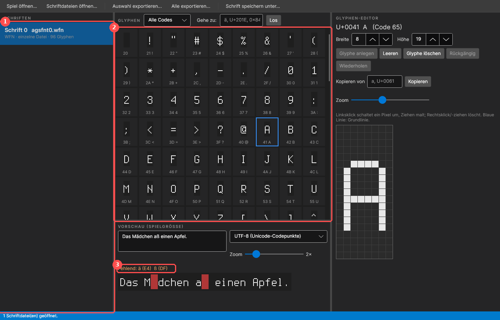
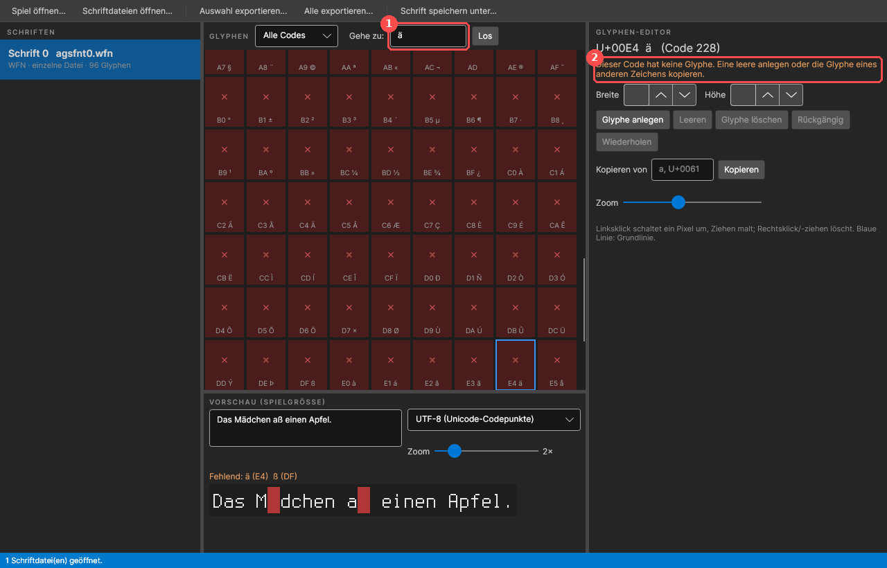
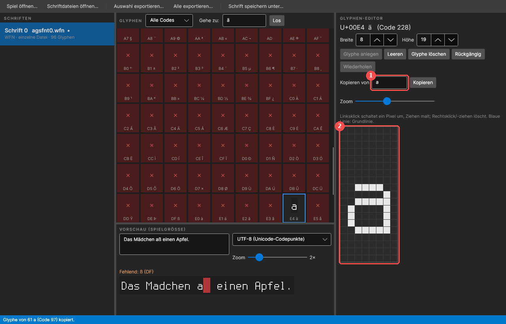
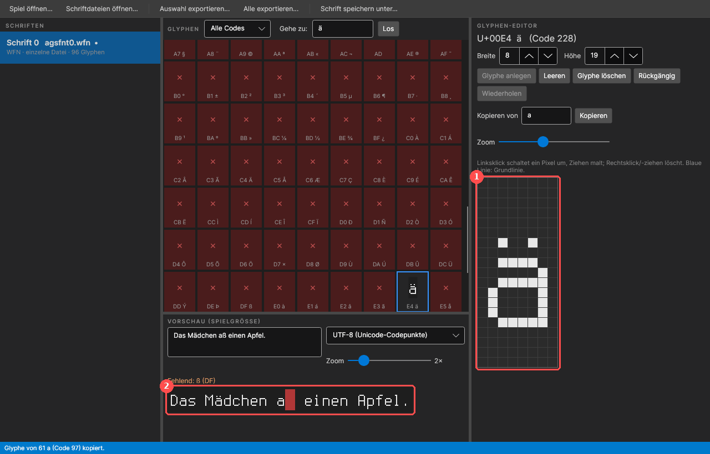
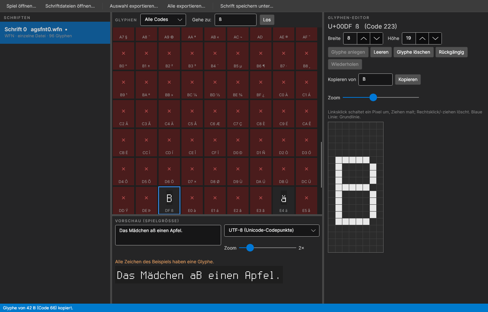
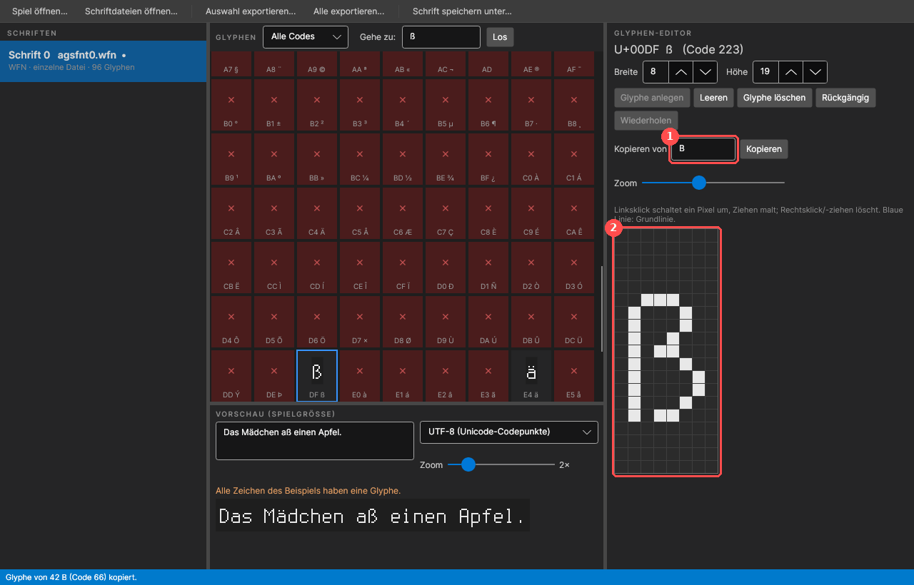
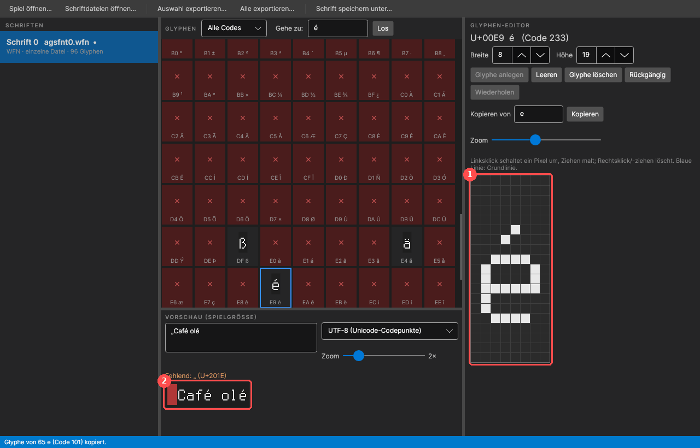
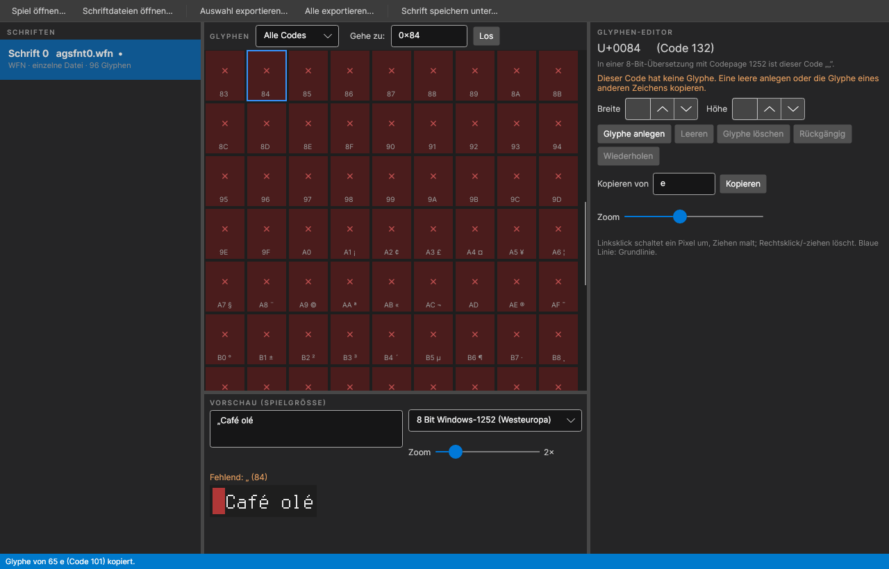
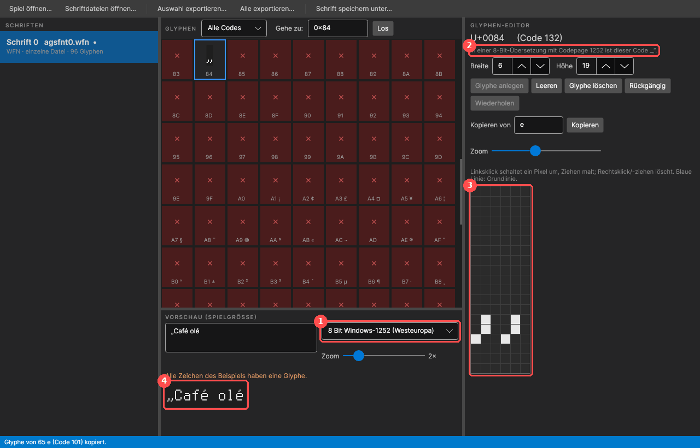

# Schrift-Editor – Umlaute und Sonderzeichen ergänzen

*English version: [en/Font-Editor.md](en/Font-Editor.md)*

Viele AGS-Spiele, besonders ältere, haben Bitmap-Fonts mit nur 128 Zeichen: Buchstaben, Ziffern und
Satzzeichen, aber keine Umlaute, kein `ß`, kein `é`. Eine deutsche oder französische Übersetzung
zeigt dann an diesen Stellen nichts oder ein falsches Zeichen. Diese Anleitung zeigt an zwei
Beispielen, wie man die fehlenden Zeichen mit dem Schrift-Editor (Font-Editor) ergänzt:

1. [Umlaute: `ä` und `ß`](#beispiel-1-umlaute-ä-und-ß)
2. [Lateinische Sonderzeichen: `é` und das deutsche `„` für eine 8-Bit-Übersetzung](#beispiel-2-é-und--für-eine-8-bit-übersetzung)

Die Bilder zeigen die deutsche Oberfläche (Sprache: *Werkzeuge → Einstellungen... → Sprache*) und
eine Beispielschrift, die aus der freien Schrift *Terminus* erzeugt wurde. Die Schriften deines
Spiels sehen anders aus, die Schritte sind dieselben. Die allgemeine Beschreibung aller Knöpfe steht
im [Benutzerhandbuch, Kapitel 7](Anleitung.md#7-font-editor).

## Inhalt

1. [Vorbereitung](#vorbereitung)
2. [Beispiel 1: Umlaute `ä` und `ß`](#beispiel-1-umlaute-ä-und-ß)
3. [Beispiel 2: `é` und `„` für eine 8-Bit-Übersetzung](#beispiel-2-é-und--für-eine-8-bit-übersetzung)
4. [Speichern und ins Spiel bringen](#speichern-und-ins-spiel-bringen)
5. [Welches Zeichen woraus?](#welches-zeichen-woraus)
6. [Tipps](#tipps)

## Vorbereitung

1. **Schrift-Editor starten:** eigenständig (`AGSFontEditor.App`) oder im Translator über
   *Werkzeuge → Schrift-Editor...*.
2. **Welche Fonts brauchen Arbeit?** Beim Erstellen der TRA warnt der Translator (bzw.
   `AGSTranslate trs2tra`) für jeden Font, dem Zeichen fehlen, z.B.
   `Font 0 (agsfnt0.wfn): no glyph for ü (1067×), ä (676×), ...`. Nur diese Fonts muss man bearbeiten.
3. **Fonts öffnen:** *Spiel öffnen...* lädt alle Fonts eines Spiels so, wie die Engine sie lädt.
   Alternativ mit *Alle exportieren...* die Fonts in einen eigenen Arbeitsordner kopieren und dort
   mit *Schriftdateien öffnen...* öffnen – dann hat man gleich eine Sicherung der Originale.

1. **Schriften** – alle geöffneten Fonts. Hier den Font wählen, den die TRA-Warnung nennt.
2. **Glyphen** – alle Zeichen des Fonts. Rote Felder mit × sind Zeichen ohne Glyphe.
3. **Vorschau** – der Text im Feld darüber in Spielgröße. Die Zeile *Fehlend:* nennt die Zeichen,
   die der Font nicht hat; in der Vorschau sind sie rote Kästchen. Tipp: einen typischen Satz aus
   der eigenen Übersetzung einfügen.

## Beispiel 1: Umlaute `ä` und `ß`

### Zum Zeichen springen

Ins Feld *Gehe zu:* `ä` eingeben und *Los* drücken (oder Enter). Statt des Zeichens geht auch
`U+00E4`, `0xE4` oder `228`.

1. **Gehe zu** – springt zum Zeichen und wählt es im Raster aus.
2. Der Glyphen-Editor meldet: *Dieser Code hat keine Glyphe.* Man kann jetzt eine leere Glyphe
   anlegen (*Glyphe anlegen*) oder – meistens besser – die Glyphe eines ähnlichen Zeichens kopieren.

### Grundbuchstaben kopieren

Bei *Kopieren von* `a` eingeben und *Kopieren* drücken. Das `ä` ist jetzt eine Kopie des `a`:
gleiche Breite, gleiche Höhe, gleiche Lage auf der Grundlinie.

1. **Kopieren von** – Quelle der Kopie (Zeichen oder Code).
2. **Pixel-Editor** – die kopierte Glyphe, groß dargestellt. Mit *Zoom* darüber lässt sich die Größe
   ändern.

### Punkte setzen

Jetzt die zwei Punkte über das `a` setzen: **Linksklick** schaltet ein Pixel ein, Ziehen malt,
**Rechtsklick** löscht. Orientierung: der Punkt des `i` im selben Font zeigt, wie groß ein Punkt
ist und wie viel Abstand er zum Buchstaben hat. Hier ein Pixel je Punkt, eine Zeile Abstand.

1. Die zwei Punkte im Pixel-Editor.
2. Die Vorschau zeigt das neue `ä` sofort; im Raster ist das Feld nicht mehr rot. Fehlt nur noch
   das `ß`.

Ein Fehler? *Rückgängig* (Strg+Z) und *Wiederholen* (Strg+Y) gehen Schritt für Schritt zurück.

`ö`, `ü` entstehen genauso aus `o` und `u`. **Großbuchstaben** (`Ä`, `Ö`, `Ü`): Hat der Font über
den Großbuchstaben noch freie Zeilen (wie hier), setzt man die Punkte einfach darüber. Reichen die
Zeilen nicht, muss der Buchstabe eine Zeile niedriger werden: eine mittlere Zeile mit *Rechtsklick*
löschen und den oberen Teil eine Zeile tiefer neu malen. Die Höhe der Glyphe (*Höhe*) zu
vergrößern hilft nicht, die Glyphe wird von oben gezeichnet und würde nach unten rutschen.

### `ß` aus `B`

Ein `ß` hat keine direkte Vorlage, das `B` kommt ihm am nächsten: *Gehe zu* `ß`, *Kopieren von*
`B`.

Dann umformen: die linke obere Ecke abrunden, den mittleren Querstrich zum Knick machen und den
unteren Bogen unten links öffnen, sodass der Stamm frei steht.

1. Kopiert wurde von `B`.
2. Das umgeformte `ß`. Die Vorschau meldet jetzt *Alle Zeichen des Beispiels haben eine Glyphe.*

## Beispiel 2: `é` und `„` für eine 8-Bit-Übersetzung

### Akzente: `é` aus `e`

Lateinische Sonderzeichen mit Akzent entstehen wie Umlaute: *Gehe zu* `é`, *Kopieren von* `e`,
dann den Akzent darüber malen – beim Akut zwei Pixel schräg von rechts oben nach links unten.

1. Der Akzent im Pixel-Editor.
2. Die Vorschau mit `Café olé`. Das `„` am Anfang fehlt noch (rotes Kästchen).

### Anführungszeichen in einer 8-Bit-Übersetzung

Bei einer **8-Bit-Übersetzung** (das übliche Format für Spiele, die ihre Texte in 8 Bit speichern,
siehe [Benutzerhandbuch, Kapitel 6](Anleitung.md#6-umlaute-ß-und-anführungszeichen)) sucht die
Engine jedes Zeichen über sein Byte in der Codepage des Spiels. Für Umlaute ist das bequem: `ä` hat
in Windows-1252 den Code `0xE4`, genau wie in Unicode. Typografische Zeichen liegen aber woanders:

| Zeichen | Unicode | 8 Bit (Windows-1252) |
|---|---|---|
| `„` | U+201E | `0x84` |
| `“` | U+201C | `0x93` |
| `”` | U+201D | `0x94` |
| `–` | U+2013 | `0x96` |
| `…` | U+2026 | `0x85` |

So legt man das `„` für eine 8-Bit-Übersetzung an:

1. Rechts neben der Vorschau die Kodierung auf **8 Bit Windows-1252 (Westeuropa)** stellen (bzw. die
   Codepage des Spiels – nach *Spiel öffnen...* steht sie in der Liste). Die Vorschau schlägt die
   Zeichen jetzt so nach wie das Spiel.
2. *Gehe zu* `0x84`. Der Editor zeigt an, für welches Zeichen der Code steht.

3. *Glyphe anlegen* drücken, die *Breite* einstellen (hier 6) und die zwei Kommas malen – unten auf
   der Grundlinie, die Schwänzchen eine Zeile tiefer.

1. **Kodierung der Vorschau**: 8 Bit Windows-1252.
2. Der Hinweis: *In einer 8-Bit-Übersetzung mit Codepage 1252 ist dieser Code „„“.*
3. Das neue Zeichen im Pixel-Editor.
4. Die Vorschau zeigt `„Café olé` vollständig.

Das `“` (`0x93`) entsteht genauso. Wer sich die Arbeit sparen will, verwendet in der Übersetzung
einfach gerade Anführungszeichen `"` und den Bindestrich `-` – die hat jeder Font.

**UTF-8-Übersetzung:** Hier sucht die Engine nach dem Unicode-Code. Dann in der Vorschau
*UTF-8 (Unicode-Codepunkte)* wählen und die Zeichen unter ihrem Unicode-Code anlegen
(*Gehe zu* `„` bzw. `U+201E`). Bei Umlauten ist beides derselbe Code.

## Speichern und ins Spiel bringen

1. **Schrift speichern unter...** – unter dem **gleichen Dateinamen** speichern, den der Font im
   Spiel hat (`agsfnt0.wfn`, `agsfnt3.ttf` …, steht in der Liste *Schriften*). Am besten in einen
   eigenen Ordner, nicht direkt in den Spielordner. Der Editor überschreibt nie selbst eine Datei.
2. **Ins Spiel bringen:** am einfachsten mit
   `AGSTranslate install <Spiel> Deutsch.tra <Ordner mit den Fonts>` – das kopiert TRA und Fonts in
   den Spielordner, legt vorher eine Sicherung an und lässt sich mit `uninstall` rückgängig machen
   ([CLI-Anleitung](CLI.md)). Von Hand: die `agsfntN.*`-Datei in den Spielordner legen; eine lose
   Datei dort hat Vorrang vor dem Font im Spielpaket, die `.ags`/EXE bleibt unverändert.
3. **Prüfen:** TRA neu erstellen – die Warnung `no glyph for ...` für diesen Font sollte weg sein.
   Bleibt sie, fehlt noch ein Zeichen, oder es wurde unter dem falschen Code angelegt (UTF-8 statt
   8 Bit oder umgekehrt). Zum Schluss im Spiel ansehen.

## Welches Zeichen woraus?

| Zeichen | Kopieren von | Dann |
|---|---|---|
| `ä ö ü` | `a o u` | zwei Punkte darüber |
| `Ä Ö Ü` | `A O U` | zwei Punkte darüber, Buchstabe ggf. eine Zeile niedriger |
| `ß` | `B` | links oben runden, unten links öffnen |
| `é è ê ë` | `e` | Akzent: Akut ´, Gravis `` ` ``, Zirkumflex ^, Trema ¨ |
| `á à â`, `í ì î ï`, `ó ò ô`, `ú ù û` | `a`, `i`, `o`, `u` | Akzent darüber; beim `i` vorher den Punkt löschen |
| `É È Ê` | `E` | wie bei den Großbuchstaben-Umlauten |
| `ç Ç` | `c C` | kleines Häkchen unter die Grundlinie |
| `ñ Ñ` | `n N` | Tilde ~ darüber |
| `œ Œ` | `o O` | *Breite* vergrößern, `e`/`E` rechts daneben malen |
| `¿ ¡` | `? !` | auf den Kopf stellen (oben ↔ unten malen) |
| `„ “ ”` | `,` bzw. `'` | zwei Kommas/Häkchen nebeneinander, *Breite* anpassen |
| `–` | `-` | *Breite* vergrößern, Strich verlängern |

## Tipps

- **Outline-Fonts:** Steht in der Liste bei einem Font *Outline: font N*, wird der Text erst mit
  Font *N* als Umriss gezeichnet. Ein neues Zeichen gehört dann auch in Font *N*, sonst fehlt der
  Umriss.
- **Gleiche Fonts:** Oft gibt es mehrere Fonts mit demselben Aussehen (z.B. normal und mit Umriss).
  Ein fertiges Zeichen kann man nicht zwischen Fonts kopieren, aber die Pixel stehen ja im Bild –
  einfach abzeichnen.
- **TrueType-Pixelfonts** bearbeitet man genauso; der Editor erkennt ihr Pixelraster. Normale
  Vektorfonts (Arial, Times …) lassen sich nur ansehen, sie haben Umlaute und Akzente aber meistens
  schon.
- **Kleine Fonts:** Bei sehr kleinen Fonts (3–4 Pixel hohe Buchstaben) ist kein Platz für Punkte
  über dem Buchstaben. Dann den Buchstaben um eine Zeile kürzen oder die Punkte in die oberste
  Zeile des Buchstabens legen – lesbar ist wichtiger als schön.
- **Nur Fonts weitergeben, die man weitergeben darf:** Die Fonts gehören zum Spiel. Für ein
  Spielerpaket (`AGSTranslate pack`) gilt dasselbe wie für die Übersetzung selbst: vorher die
  Erlaubnis der Entwickler einholen.
