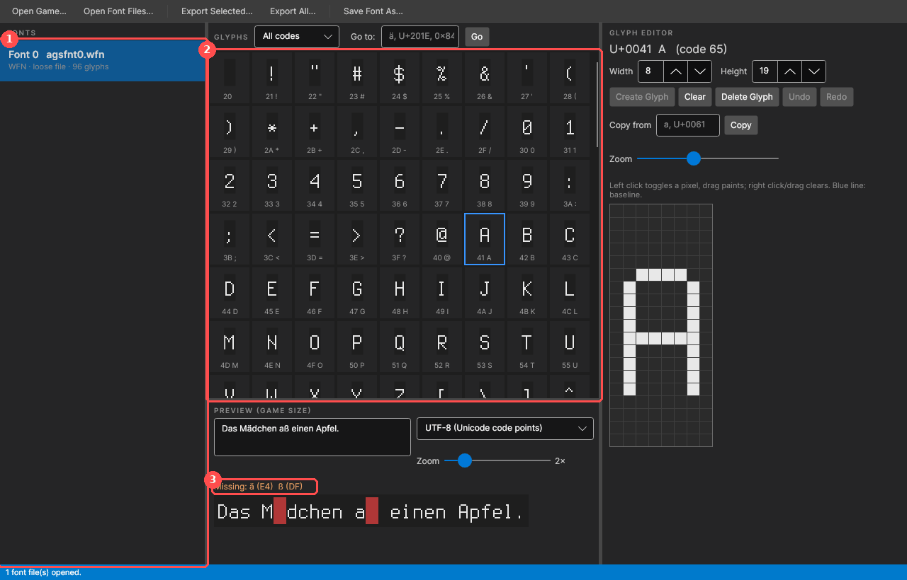
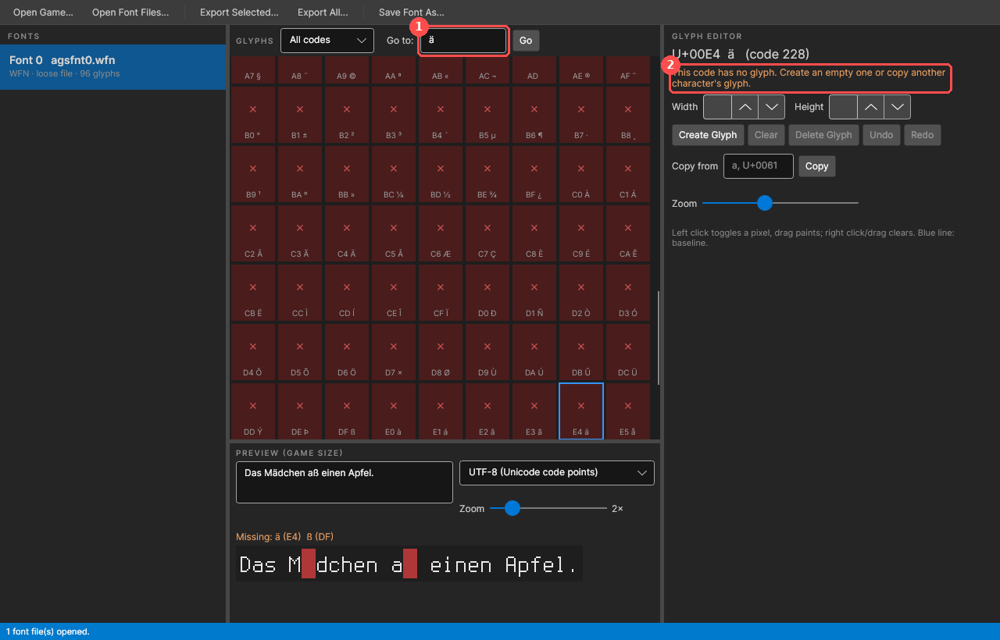
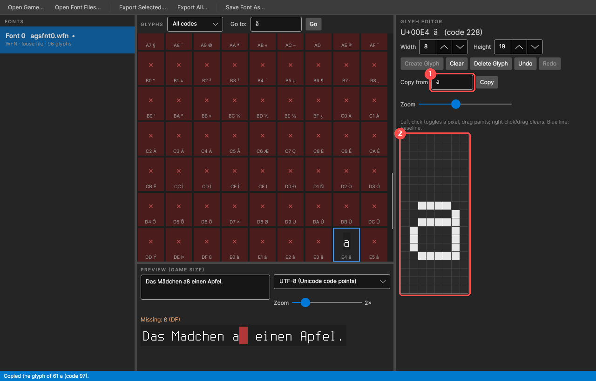
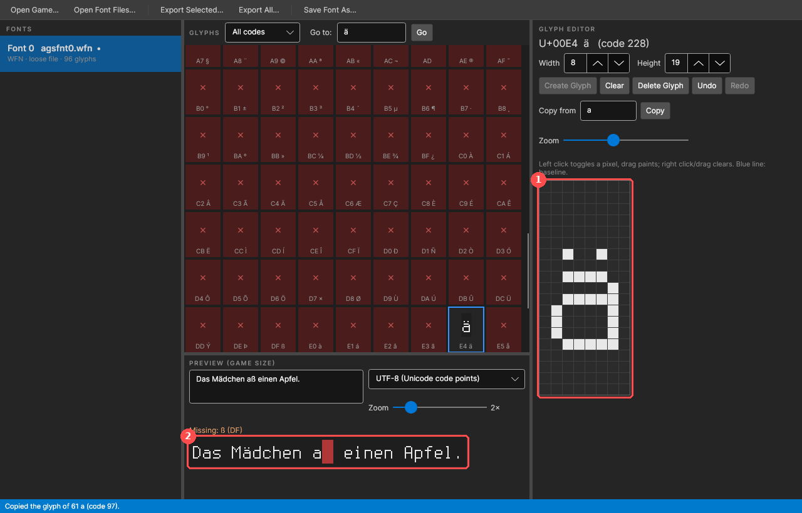
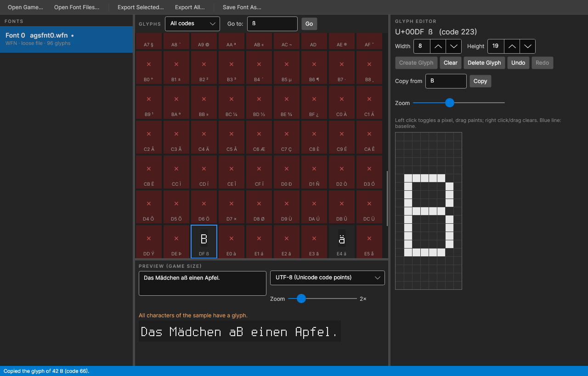
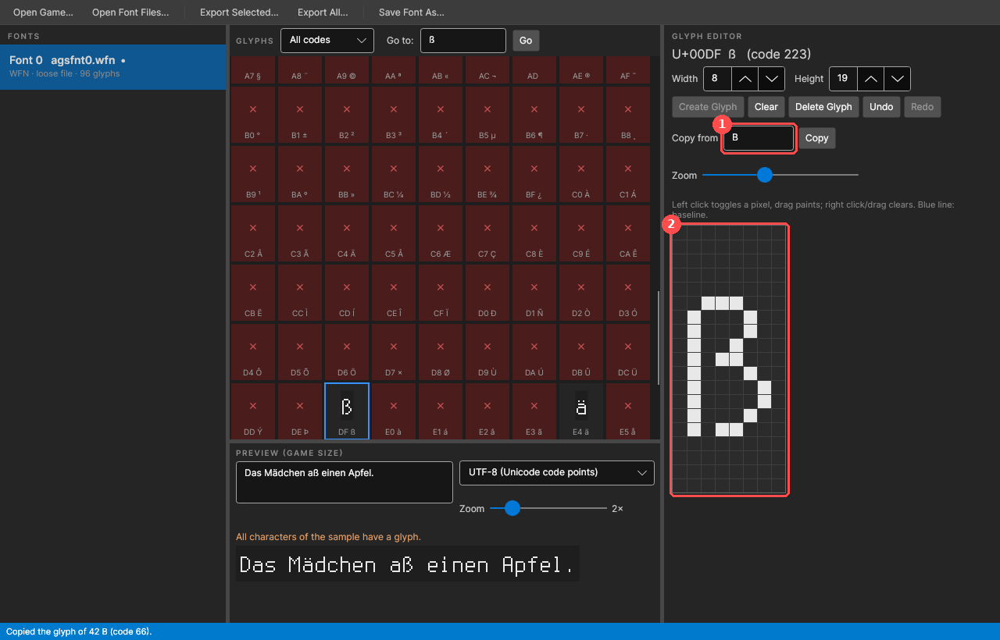
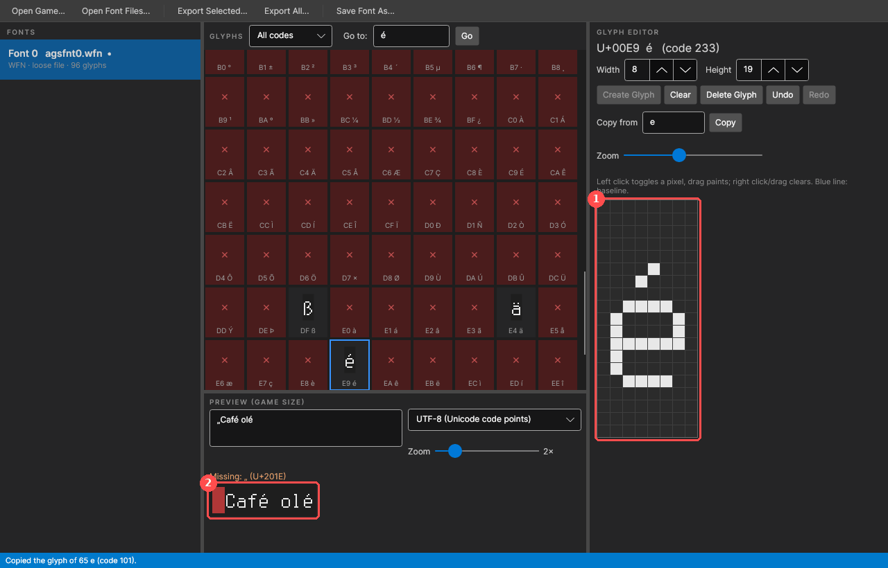
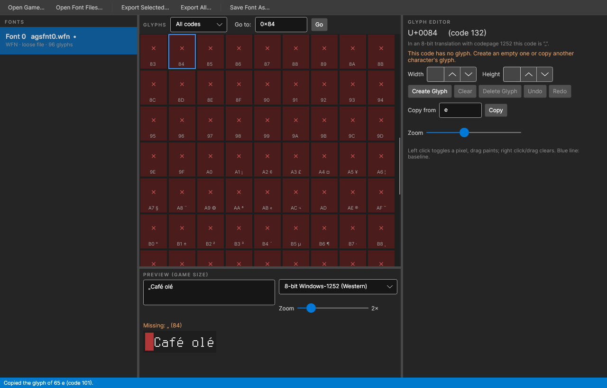
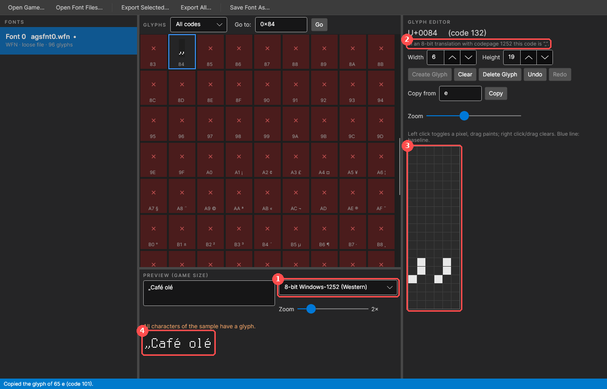

# Font Editor – adding umlauts and special characters

*Deutsche Fassung: [Font-Editor.md](../Font-Editor.md)*

Many AGS games, especially older ones, have bitmap fonts with only 128 characters: letters, digits and
punctuation, but no umlauts, no `ß`, no `é`. A German or French translation then shows nothing or a
wrong character in those places. This guide shows with two examples how to add the missing
characters with the Font Editor:

1. [Umlauts: `ä` and `ß`](#example-1-umlauts-ä-and-ß)
2. [Latin special characters: `é` and the German `„` for an 8-bit translation](#example-2-é-and--for-an-8-bit-translation)

The pictures show the English interface and a demo font made from the free font *Terminus*. Your
game's fonts look different, the steps are the same. All buttons are described in the
[user guide, chapter 7](UserGuide.md#7-font-editor).

## Contents

1. [Preparation](#preparation)
2. [Example 1: umlauts `ä` and `ß`](#example-1-umlauts-ä-and-ß)
3. [Example 2: `é` and `„` for an 8-bit translation](#example-2-é-and--for-an-8-bit-translation)
4. [Saving and getting it into the game](#saving-and-getting-it-into-the-game)
5. [Which character from which?](#which-character-from-which)
6. [Tips](#tips)

## Preparation

1. **Start the Font Editor:** standalone (`AGSFontEditor.App`) or in the translator via
   *Tools → Font Editor...*.
2. **Which fonts need work?** When creating the TRA, the translator (or `AGSTranslate trs2tra`)
   warns about every font that lacks characters, e.g.
   `Font 0 (agsfnt0.wfn): no glyph for ü (1067×), ä (676×), ...`. Only these fonts need editing.
3. **Open the fonts:** *Open Game...* loads all fonts of a game the way the engine loads them.
   Or copy the fonts into a work folder with *Export All...* and open them there with
   *Open Font Files...* – that also gives you a backup of the originals.

1. **Fonts** – all open fonts. Choose the font named in the TRA warning.
2. **Glyphs** – all characters of the font. Red cells with × are characters without a glyph.
3. **Preview** – the text in the box above at game size. The line *Missing:* names the characters
   the font doesn't have; in the preview they are red boxes. Tip: paste a typical sentence from your
   translation.

## Example 1: umlauts `ä` and `ß`

### Jumping to the character

Type `ä` into *Go to:* and press *Go* (or Enter). `U+00E4`, `0xE4` or `228` work too.

1. **Go to** – jumps to the character and selects it in the grid.
2. The glyph editor says: *This code has no glyph.* You can now create an empty glyph
   (*Create Glyph*) or – usually better – copy the glyph of a similar character.

### Copying the base letter

Type `a` into *Copy from* and press *Copy*. The `ä` is now a copy of the `a`: same width, same
height, same position on the baseline.

1. **Copy from** – the source of the copy (a character or a code).
2. **Pixel editor** – the copied glyph, enlarged. *Zoom* above it changes the size.

### Adding the dots

Now put the two dots above the `a`: **left click** turns a pixel on, dragging paints, **right click**
clears. For orientation, the dot of the `i` in the same font shows how big a dot is and how far it is
from the letter. Here one pixel per dot, one row of space.

1. The two dots in the pixel editor.
2. The preview shows the new `ä` at once; in the grid the cell is no longer red. Only the `ß` is
   missing now.

A mistake? *Undo* (Ctrl+Z) and *Redo* (Ctrl+Y) go back step by step.

`ö` and `ü` are made the same way from `o` and `u`. **Capital letters** (`Ä`, `Ö`, `Ü`): if the font
has free rows above the capitals (as here), just put the dots there. If there isn't enough room, the
letter has to become one row shorter: clear a middle row with *right click* and repaint the upper
part one row lower. Increasing the glyph's *Height* doesn't help, because the glyph is drawn from the
top and would slide down.

### `ß` from `B`

There is no direct template for `ß`; the `B` comes closest: *Go to* `ß`, *Copy from* `B`.

Then reshape it: round off the top left corner, turn the middle bar into a kink and open the lower
bowl at the bottom left so the stem stands free.

1. Copied from `B`.
2. The reshaped `ß`. The preview now says *All characters of the sample have a glyph.*

## Example 2: `é` and `„` for an 8-bit translation

### Accents: `é` from `e`

Latin special characters with accents are made like umlauts: *Go to* `é`, *Copy from* `e`, then
paint the accent above it – for an acute two pixels slanting from top right to bottom left.

1. The accent in the pixel editor.
2. The preview with `Café olé`. The `„` at the start is still missing (red box).

### Quotation marks in an 8-bit translation

In an **8-bit translation** (the usual format for games that store their texts as 8-bit, see
[user guide, chapter 6](UserGuide.md#6-umlauts-accents-and-quotation-marks)) the engine looks up every
character by its byte in the game's codepage. For umlauts that is convenient: `ä` has code `0xE4` in
Windows-1252, the same as in Unicode. Typographic characters are elsewhere, though:

| Character | Unicode | 8-bit (Windows-1252) |
|---|---|---|
| `„` | U+201E | `0x84` |
| `“` | U+201C | `0x93` |
| `”` | U+201D | `0x94` |
| `–` | U+2013 | `0x96` |
| `…` | U+2026 | `0x85` |

This is how to add the `„` for an 8-bit translation:

1. Next to the preview, set the encoding to **8-bit Windows-1252 (Western)** (or the game's
   codepage – after *Open Game...* it is in the list). The preview now looks up characters the way
   the game does.
2. *Go to* `0x84`. The editor shows which character the code stands for.

3. Press *Create Glyph*, set the *Width* (here 6) and paint the two commas – on the baseline, with
   the tails one row lower.

1. **Preview encoding**: 8-bit Windows-1252.
2. The hint: *In an 8-bit translation with codepage 1252 this code is “„”.*
3. The new character in the pixel editor.
4. The preview shows `„Café olé` completely.

The `“` (`0x93`) is made the same way. To save the work, use straight quotes `"` and the hyphen `-`
in the translation – every font has those.

**UTF-8 translation:** here the engine looks up the Unicode code. Choose
*UTF-8 (Unicode code points)* in the preview and add the characters under their Unicode code
(*Go to* `„` or `U+201E`). For umlauts both are the same code.

## Saving and getting it into the game

1. **Save Font As...** – save under the **same file name** the font has in the game
   (`agsfnt0.wfn`, `agsfnt3.ttf` …, shown in the *Fonts* list). Preferably into a folder of its own,
   not straight into the game folder. The editor never overwrites a file by itself.
2. **Get it into the game:** easiest with
   `AGSTranslate install <game> German.tra <folder with the fonts>` – it copies the TRA and the fonts
   into the game folder, makes a backup first and can be undone with `uninstall`
   ([CLI guide](CLI.md)). By hand: put the `agsfntN.*` file into the game folder; a loose file there
   takes priority over the font in the game package, the `.ags`/EXE stays unchanged.
3. **Check:** create the TRA again – the warning `no glyph for ...` for this font should be gone.
   If it stays, a character is still missing or was added under the wrong code (UTF-8 instead of
   8-bit or the other way round). Finally, look at it in the game.

## Which character from which?

| Character | Copy from | Then |
|---|---|---|
| `ä ö ü` | `a o u` | two dots above |
| `Ä Ö Ü` | `A O U` | two dots above, make the letter one row shorter if needed |
| `ß` | `B` | round the top left, open the bottom left |
| `é è ê ë` | `e` | accent: acute ´, grave `` ` ``, circumflex ^, diaeresis ¨ |
| `á à â`, `í ì î ï`, `ó ò ô`, `ú ù û` | `a`, `i`, `o`, `u` | accent above; for `i` clear the dot first |
| `É È Ê` | `E` | like the capital umlauts |
| `ç Ç` | `c C` | small hook below the baseline |
| `ñ Ñ` | `n N` | tilde ~ above |
| `œ Œ` | `o O` | increase *Width*, paint an `e`/`E` next to it |
| `¿ ¡` | `? !` | turn it upside down (paint top ↔ bottom) |
| `„ “ ”` | `,` or `'` | two commas/ticks side by side, adjust *Width* |
| `–` | `-` | increase *Width*, extend the line |

## Tips

- **Outline fonts:** if the list shows *Outline: font N* for a font, the text is first drawn with
  font *N* as an outline. A new character then belongs into font *N* too, otherwise the outline is
  missing.
- **Matching fonts:** games often have several fonts that look the same (e.g. plain and outlined).
  A finished character can't be copied between fonts, but the pixels are right there – just copy
  them by eye.
- **TrueType pixel fonts** are edited the same way; the editor detects their pixel grid. Ordinary
  vector fonts (Arial, Times …) can only be viewed, but they usually have umlauts and accents
  already.
- **Small fonts:** very small fonts (letters 3–4 pixels high) have no room for dots above the
  letter. Make the letter one row shorter or put the dots into the letter's top row – readable is
  more important than pretty.
- **Only pass on fonts you may pass on:** the fonts belong to the game. For a player package
  (`AGSTranslate pack`) the same applies as for the translation itself: ask the developers first.
